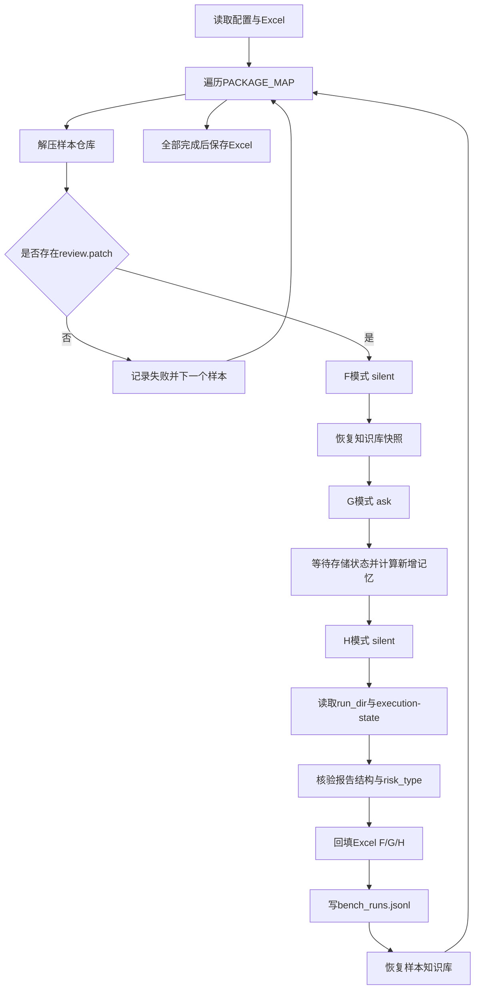
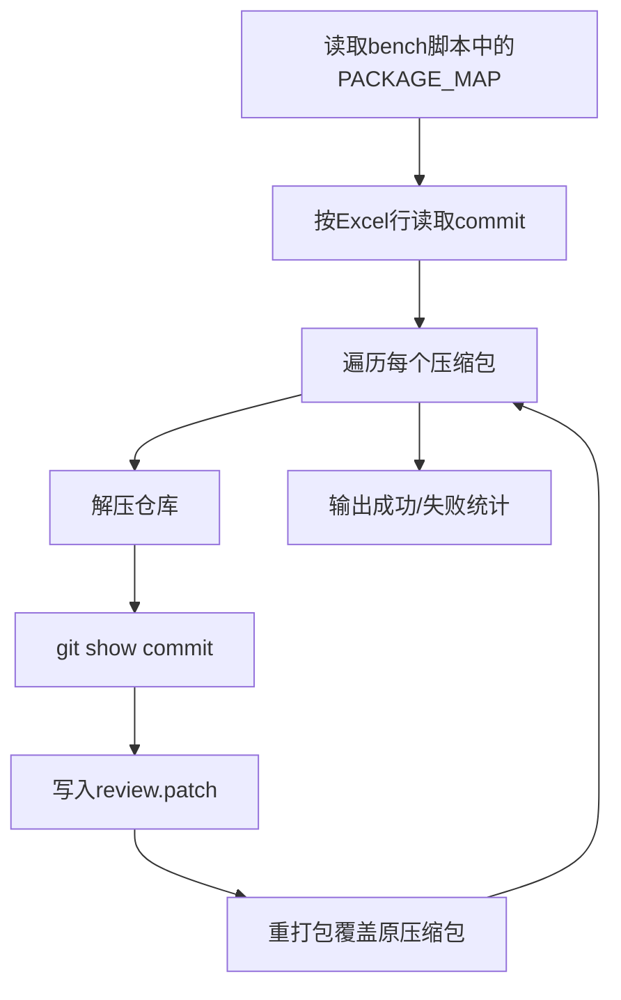

## 1. 目标与范围
本说明文档覆盖以下脚本的端到端流程与关键细节：

- `co-review_bench/bench_fill_full_exe.py`
  - 主批量评测脚本（F/G/H 三模式）
  - 通过 iCode ACP + Co-Review MCP 执行完整审查
- `co-review_bench/generate_review_patches.py`
  - 为样本压缩包内仓库批量生成 `review.patch`
- `co-review_bench/setup_windows_env.ps1`
  - Windows 一键创建 `.venv` 与安装依赖
- `co-review_bench/requirements.windows.txt`
  - Windows 基础依赖清单

---

## 2. 主流程总览（`bench_fill_full_exe.py`）

### 2.1 输入
- Excel：`BENCH_XLSX`
- 样本压缩包目录：`PKG_DIR`
- 样本映射：`PACKAGE_MAP`（压缩包名 -> Excel 行号）
- iCode 可执行文件：`ICODE`（`.exe`）

### 2.2 核心步骤
1. 读取配置与 Excel 工作表。
2. 遍历 `PACKAGE_MAP` 中每个样本。
3. 解压样本仓库并定位 `review.patch`。
4. 每个样本执行三轮：
   - F: `silent`
   - G: `ask`
   - H: `silent`（观察 G 的记忆影响）
5. 从 run 目录核验报告并映射为结果文案。
6. 回填 Excel 的 F/G/H 列。
7. 将完整旁证写入 `bench_runs.jsonl`。
8. 样本结束恢复知识库，全部结束保存 Excel。

### 2.3 F/G/H 语义
- F（baseline）
  - 静默审查，不提问，作为基线结果。
- G（ask）
  - 允许 Agent 通过 `ask_user` 提问。
  - 自动回复优先级：`SUPPLEMENTAL_ANSWERS[repo_name]` -> Excel D 列（待确认主题）-> `不确定`。
  - 等待记忆存储 worker 状态。
- H（memory-after-silent）
  - 再次静默审查。
  - 检查 G 产生的新记忆是否被召回并应用到计划。

---

## 3. iCode 与 Co-Review 的衔接机制

### 3.1 iCode ACP 启动
每轮会通过子进程启动：
- `icode.exe acp -a <临时profile> ...`

### 3.2 临时 profile
脚本会复制 `~/.chrys/agents/Code.yaml`，生成临时 profile，并重写：
- `co-review` MCP server 的 `command` 指向当前 `SKILL_ROOT/co-review`

### 3.3 Prompt 驱动 Co-Review
脚本构造强约束 prompt，要求 Agent：
1. 先执行 `co-review prepare --input <request.json>`
2. 必须使用 prepare 返回的真实任务与 `report_path`
3. 通过 Co-Review MCP 完成后续检查
4. 最终 JSON 写回 `report_path` 且可解析

---

## 4. 报告核验与结果判定

### 4.1 核验路径
每轮执行后：
1. 通过 `session_id` 获取 `run_dir` 绑定。
2. 校验 `execution-state.json` 存在。
3. 从 `execution-state.json` 读取 `report_path`。
4. 解析报告并校验顶层结构字段：
   - `repository`
   - `findings`
   - `remaining_questions`
   - `confirmation_history`

### 4.2 当前判定规则
`classify_risk` 规则如下：
- `confirmed_vulnerability` -> `是(risk_type=confirmed_vulnerability)`
- `not_vulnerable` -> `是(risk_type=not_vulnerable)`
- `potential` / `potential_risk` -> `否(risk_type=...)`
- 其他异常 -> `报告缺失/异常`

### 4.3 Excel 回填
- F 结果写第 6 列
- G 结果写第 7 列
- H 结果写第 8 列

---

## 5. 旁证日志与可追溯性

`bench_runs.jsonl` 每条记录包含：
- 样本基本信息（zip、row、repo、commit）
- F/G/H 各自 `run_dir`、`report_path`、`risk_type`、`val`、`error`
- G 新增记忆内容
- H 是否 recall 命中、是否 memory_applied

建议排障优先顺序：
1. 看 `bench_runs.jsonl` 的 `error` 和 `run_dir`
2. 看 `run_dir/execution-state.json`
3. 看 `report_path` 对应报告结构是否合规

---

## 6. 常见失败模式

1. `iCode ACP turn exceeded ... seconds`
- 含义：单轮 prompt 超时。
- 常见原因：模型卡顿、工具链耗时、上下文过大。

2. `iCode Host 没有为 Co-Review session 建立 run 绑定`
- 含义：session 未产生可解析 run 绑定。
- 常见原因：prepare 未成功落地、链路中断、工具调用失败。

3. `Co-Review workflow 未生成 execution-state.json`
- 含义：run 目录未形成标准状态文件。

4. `报告不符合 Co-Review 顶层结构`
- 含义：report JSON 字段不完整或类型不正确。

---

## 7. review.patch 预处理（`generate_review_patches.py`）

当样本仓库缺失 `review.patch` 时，先运行预处理脚本：

1. 从 `bench_fill_full_exe.py` 解析 `PACKAGE_MAP`
2. 从 Excel 对应行读取 `commit`
3. 解压仓库并执行 `git show <commit>`
4. 在仓库根目录写入 `review.patch`
5. 重打包覆盖原压缩包（可选 `--backup` 备份）

示例：

```bash
/data/cyjia/iCode/.venv/bin/python /data/cyjia/co-review_bench/generate_review_patches.py --backup
```

---

## 8. Windows 环境创建与运行

### 8.1 一键创建环境

```powershell
powershell -ExecutionPolicy Bypass -File .\co-review_bench\setup_windows_env.ps1
```

### 8.2 激活环境

```powershell
.\.venv\Scripts\Activate.ps1
```

### 8.3 必要环境变量（示例）

```powershell
$env:CO_REVIEW_ICODE_EXE="C:\path\to\icode.exe"
$env:CO_REVIEW_ASSET_ROOT="C:\path\to\co-review\co-review"
$env:CO_REVIEW_RUNTIME_SRC="C:\path\to\co-review\runtime-src\scripts"
$env:CO_REVIEW_BENCH_XLSX="C:\path\to\bench_info.xlsx"
$env:CO_REVIEW_PKG_DIR="C:\path\to\pkgs"
$env:CO_REVIEW_WORK_BASE="C:\path\to\work"
$env:CO_REVIEW_RUN_TIMEOUT_SEC="600"
```

### 8.4 运行批量脚本

```powershell
python .\co-review_bench\bench_fill_full_exe.py
```

---

## 9. 平台策略（Windows 优先 + Linux 回退）
`bench_fill_full_exe.py` 已实现：
- Windows 下默认路径优先（`Path.home()` 派生）
- Linux 下回退 `/data/cyjia/...` 与 `/tmp/...`
- 所有关键路径仍支持环境变量覆盖

---

## 10. 推荐执行顺序
1. 先执行 `generate_review_patches.py` 补齐样本 patch。
2. 再执行 `bench_fill_full_exe.py` 进行 F/G/H 批量评测。
3. 最后用 `bench_runs.jsonl` 做失败样本复盘。

---

## 11. 批处理流程图



## 12. patch 预处理流程图


